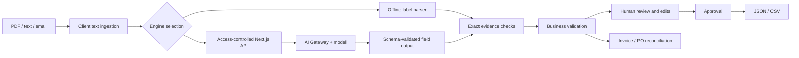

# TraceLedger

**AI-Powered Structured Data Extraction System for Unstructured Business Inputs**

TraceLedger turns business documents into reviewable structured records. Its distinguishing feature is a complete evidence-and-review workflow: preserve the original text, link extracted fields to exact source quotes, validate business rules, reconcile related documents, and record human corrections before approval.

Built as a final-year project by Pratham Gupta with AI-assisted development. The application does not claim a newly trained model or production-grade accuracy.

## Features

- Import text-layer PDFs (up to 20 pages / 3 MB), TXT, MD, EML or pasted text.
- Invoice, purchase-order and business-email schemas, with an editable typed schema contract.
- Live semantic extraction through the Vercel AI SDK and AI Gateway.
- Separately labeled offline deterministic parser for demos and baseline comparisons.
- Exact source-quote verification and field-by-field human review.
- Required-field, date, email, amount and arithmetic validation.
- Invoice-to-purchase-order reconciliation by shared order reference.
- JSON and spreadsheet-safe CSV exports, carrying draft/review state where applicable.
- Browser-local review history and opt-in local persistence.
- Eight inspectable synthetic fixtures and an evaluation UI that measures normalized exact match.
- Responsive workspace UI and a deployment build that runs core logic tests first.

## Quick start

Use Node.js 22 or 24 and npm:

```sh
npm install
npm run dev
```

Visit http://localhost:3000. The offline baseline needs no account or API key.

```sh
npm test
npm run build
npm start
```

## Live AI setup

1. Create a Vercel AI Gateway key or enable Gateway access for the deployment's Vercel OIDC identity.
2. Set `AI_GATEWAY_API_KEY` in Vercel environment variables when using a key.
3. Set `APP_ACCESS_CODE` to a strong shared demo code. The browser sends this in a request header; it is kept in memory only.
4. Optionally set `AI_MODEL`. The default is `google/gemini-3.5-flash-lite`; confirm availability and pricing in your Gateway account before use.
5. Redeploy after environment changes. In the app, open Project settings and enter the access code, then switch the engine to Live AI.

Never commit credentials. `.env.example` contains names only. Do not put server secrets in `NEXT_PUBLIC_*` variables. Live calls require model credits and are not automatically replaced with offline results on error.

The shared access code is suitable for a controlled student demo, not public multi-tenant authorization. Before opening live extraction broadly, add user authentication, durable per-user rate limits and quotas. Gateway billing limits should be set in the provider dashboard.

## Deploy to Vercel

Import this GitHub repository as a Next.js project. Build command: `npm run build`. No separate database is needed for the current browser-local version. Add the environment variables above only when enabling live AI.

## Architecture



Core modules:

| Path | Responsibility |
| --- | --- |
| `app/page.js` | Workspace, review, import, schemas, evaluation and history UI |
| `app/api/extract/route.js` | Authentication, request validation and structured AI generation |
| `lib/engine.mjs` | Offline parser, normalization, validation, evidence checks and reconciliation |
| `lib/benchmark.mjs` | Public synthetic fixtures and exact-match scoring |
| `tests/engine.test.mjs` | Core behavioral regression tests |

## Five-minute demo

1. Open the sample invoice. Select **Extract document** in Offline baseline mode.
2. Show that the invoice states 86,960 but 72,000 + 12,960 = 84,960. The app preserves the original error.
3. Click **Source linked** for Total and show the supporting source text.
4. Extract the purchase order and open **Cross-document checks**. Vendor and currency match; total conflicts by 2,000.
5. Correct the invoice total to `84960`, review every field, and approve. Explain that this is a human correction, not a modification of the source document.
6. Export JSON and show the original evidence, reviewed value, validation outcome and review history.
7. Run the baseline evaluation. Explain its failures on prose. If live AI is configured, run the model comparison and report the measured results.

Use synthetic documents in public demos. Sample company names, emails and financial values are fictional.

## Evaluation methodology

The evaluation lab reports normalized field exact match across 8 synthetic fixtures and 56 labeled fields. Empty expected values count as correct abstentions. It does not report F1, calibrated confidence, or production accuracy. Source-quote existence is checked separately and does not prove that a value is correct.

For a defensible dissertation experiment, add a held-out dataset of at least 100–200 de-identified or synthetic documents across multiple layouts. Keep development and test documents separate. Compare baseline, AI-only extraction, and AI plus verification. Report exact match, missing-field precision/recall, unsupported-value rate, latency and per-document cost, with category-level results and failure examples. Do not replace these measurements with the small included smoke-test score.

## Data handling and current limitations

- Offline parsing is browser-local. Live extraction sends text through Vercel AI Gateway to a model provider.
- No shared database or login is implemented. Persistence is opt-in localStorage on the current device; disabled by default.
- Browser-local history is not tamper-proof and must not be described as a compliance audit trail.
- Scanned PDFs and image inputs require an external OCR step before import. No OCR accuracy is claimed.
- PDF extraction depends on the text layer and may reorder table content.
- Only header-level fields are extracted; line-item table extraction is a future extension.
- Evidence matching verifies a verbatim quote, not semantic entailment or calibrated confidence.
- Schemas are session-local and can be exported as JSON.
- The baseline relies on explicit labels and will miss prose and unfamiliar layouts.
- Approvals reflect one local reviewer and do not establish document authenticity.

## Technical references

- [AI SDK structured output](https://ai-sdk.dev/docs/ai-sdk-core/generating-structured-data)
- [Vercel AI Gateway authentication](https://vercel.com/docs/ai-gateway/authentication-and-byok)
- [PDF.js](https://mozilla.github.io/pdf.js/)
- [Next.js documentation](https://nextjs.org/docs)

See `docs/PROJECT_GUIDE.md` for the academic narrative and viva preparation.
